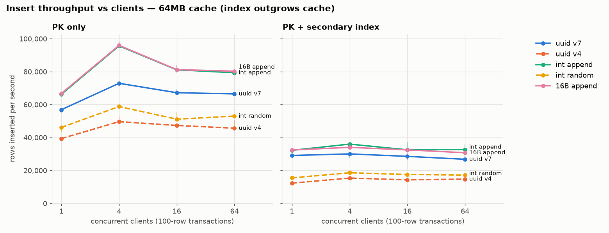
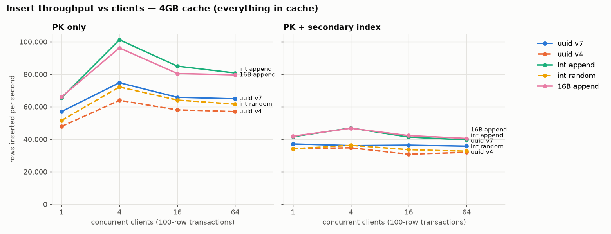
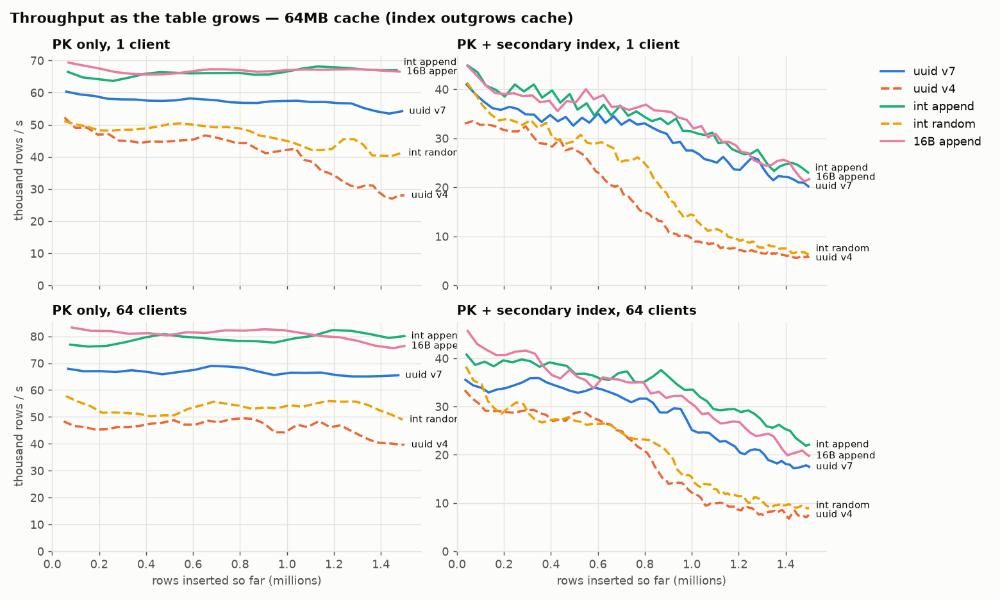
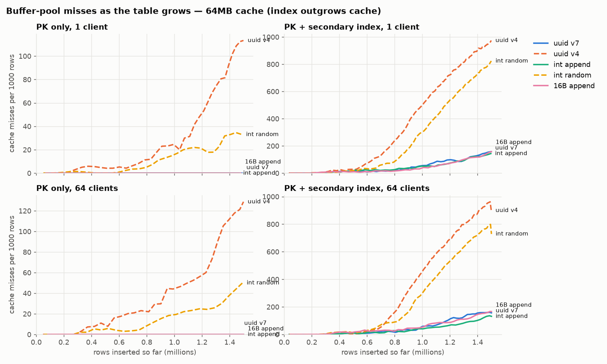
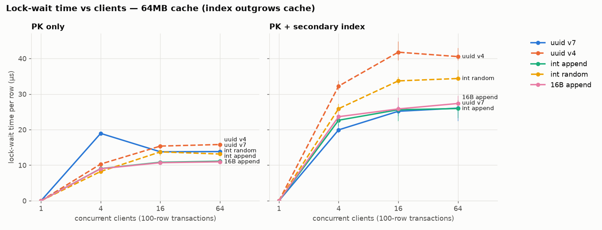
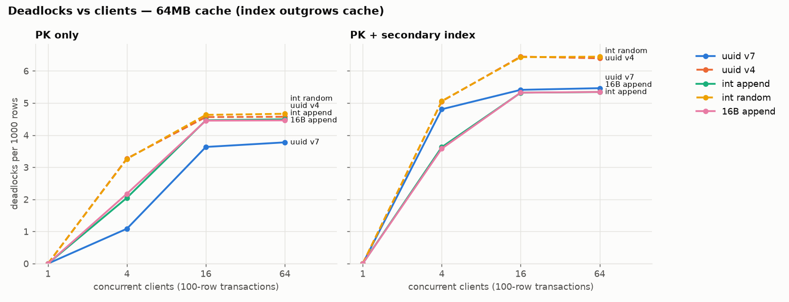
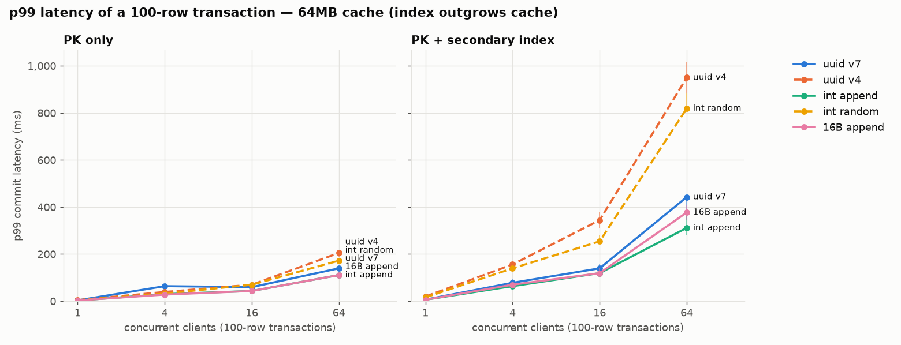
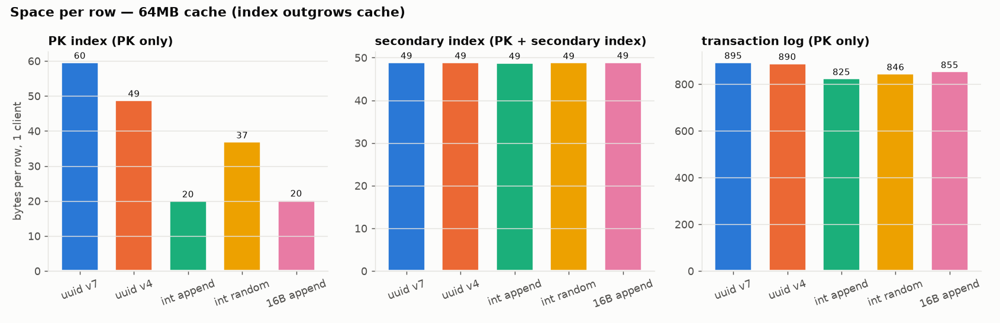

# Insert benchmark: UUID v7 vs UUID v4 vs integer keys in comdb2

This benchmark measures how the order of primary-key values affects insert
performance in comdb2. It compares time-ordered UUIDs (v7) against random
UUIDs (v4), and both against integer keys inserted in order (append) and at
random. It also tests one specific concern: that v7 keys, which all land at
the right-most leaf page of the index, make concurrent writers contend on that
page.

## Findings

1. **v7 inserts are 1.4–1.5x faster than v4 once the index is larger than the
   cache, and 2x faster when the table also has a secondary index.** Most of
   the gain comes from cache locality: v7 inserts touch only the right edge of
   the index, so they had zero buffer-pool misses, while v4 misses grew steadily
   as the table grew. When everything fits in cache, v7 is only 1.1–1.2x faster.

2. **Right-edge contention exists, but it is small and does not grow with
   concurrency.**
   - At 4 clients, v7 had about twice the lock-wait time per row of the
     append-only keys (19 µs vs 9 µs) and twice the p99 latency (64 ms vs
     30 ms).
   - At 16 and 64 clients the gap shrinks to 14 µs vs 11 µs, and v7 has the
     *fewest* deadlocks of all key types.
   - v7's throughput relative to int append is about the same with 1 client
     (0.86x, where contention is impossible) as with 64 clients (0.84x). So the
     gap is a single-writer cost, not contention.

3. **Every key type stops scaling at 4 clients, including the random keys that
   have no hot page.** The ceiling is common to all workloads, so it is not
   right-edge contention. With page locks, concurrent B-tree inserts deadlock
   (3.6–6.5 per 1000 rows at 16 or more clients). comdb2 retries each deadlocked
   transaction after a random sleep and lowers the effective number of write
   threads (`handle_op_local` in `db/sltdbt.c`). Adding clients just adds
   deadlocks.

4. **Why v7 is slower than int append, even with 1 client:** v7's PK index is 3x
   larger per row than the append-only keys' (60 vs 20 bytes per row), and even
   larger than v4's (49). At ~57k rows/s, about 57 keys share each millisecond
   and arrive in random order within it. So inserts land *near*, not *at*, the
   end of the right-most leaf. The likely cause is that such pages split in the
   middle and the left halves are never filled afterwards. That leaves v7's
   index pages much emptier than v4's, which random inserts eventually fill.
   This explanation is inferred from file sizes and was not verified at the page
   level. A v7 generator with a monotonic counter within each millisecond
   (RFC 9562 §6.2, methods 1 or 3) would make keys strictly increasing for each
   client and would probably close most of the gap. That variant was not
   measured.

5. **An unrelated secondary index hides the right-edge effect completely.** The
   secondary index here is on a random value, so its inserts are randomly
   placed and outgrow the cache too. Throughput for every key type drops to
   27–36k rows/s (64MB cache). v7's extra lock wait at 4 clients disappears
   (20 µs vs 23 µs for int append), and at 16 and 64 clients v7 and int append
   have the same lock-wait time.

## What was run

**Key types.** All keys are generated by the client and bound as parameters. The
comdb2 server is unmodified.

| name | column | generator |
|---|---|---|
| `int_seq` (int append) | `longlong` | shared counter; each transaction takes the next 100 values |
| `int_rand` (int random) | `longlong` | uniform random 64-bit value |
| `seq16` (16B append) | `byte[16]` | same counter, big-endian in the last 8 bytes; separates the effect of key width from the effect of order |
| `v7` (uuid v7) | `byte[16]` | RFC 9562 v7: 48-bit Unix milliseconds, then random bits (no counter within a millisecond) |
| `v4` (uuid v4) | `byte[16]` | RFC 9562 v4: random |

**Table shapes.**

```
schema { <key column> k  longlong v  byte pad[150] }
pk:      keys { "PK" = k }
pk_sec:  keys { "PK" = k   dup "SEC" = v }        -- v is a random 64-bit value
```

The pad column holds random bytes.

**Load.**
- Each transaction is one 100-row multi-row `INSERT` in autocommit.
- 1, 4, 16 or 64 concurrent clients.
- Each run inserts 1.5M rows into a freshly created table.

**Two cache configurations, each starting from a newly created database:**

| config | comdb2 cache | rows per run | repetitions | runs |
|---|---|---|---|---|
| `main` | 64MB (the comdb2 default) | 1.5M | 3 | 120 |
| `incache` | 4GB | 1.5M | 1 | 40 |

With the 64MB cache, the v4 PK index outgrows the cache about a quarter of the
way through a run. comdb2 uses direct I/O by default (`directio ON`), so a cache
miss is a real NVMe read; the host's 1.1 TiB of RAM does not act as a hidden
page cache.

**Run order.** Within each repetition, the order of client counts, shapes and
key types is shuffled, so drift on the host does not line up with one workload.
Before each run, the table is dropped and recreated, and the cache is flushed
(`sys.cmd.send('flush')`).

**What each run records.**
- `results/<config>/runs.csv`, one row per run:
  - throughput and commit-latency percentiles
  - deltas of server counters from `comdb2_metrics`: lock waits, lock-wait
    time, deadlocks, retries, cache hits and misses
  - bytes written to the transaction log (`bdb logstat`)
  - on-disk size of the data and index files after a flush
- `results/<config>/ts/<run>.ts.csv`: the same client and server counters
  sampled every second.

## Setup

From `results/main/env.txt`:

| | |
|---|---|
| host | c2btda-pw-928, the least loaded C2BTDA host when the run started (5% CPU over 15 minutes) |
| CPU | 2x Xeon Gold 6240, 72 logical CPUs, 2 NUMA nodes |
| RAM | 1.1 TiB |
| disk | XFS on LVM over Intel P4510 NVMe (SSDPE2KX080T8) |
| OS | RHEL 8.10, kernel 4.18.0-553 |
| comdb2 | `a6948d3ff` (branch `uuid-v7`), RelWithDebInfo, gcc 8.5 |
| topology | one node; clients run on the same host |
| locking | page locks (`init_with_rowlocks 0`) |
| writer threads | `maxwt 8` (default): at most 8 transactions are applied on the master at once |
| other settings | defaults: `maxretries 500`, `penaltyincpercent 20`, `checkpointtime 60`, `logfilesize 40MB` |
| run time | 2026-10-14 12:51–14:52 EDT; 92 + 21 minutes of measured insert time |

The database registers with a private pmux on port 15105. The host's shared
pmux handed out a port that another process was already using for UDP.

## Results

Each point is the median of 3 repetitions. Whiskers show min..max. The median
spread between repetitions is 7% of the median (worst case 20%). Full tables for
every metric are in [`results/summary.md`](results/summary.md).

### Throughput




Rows per second with the 64MB cache:

| shape | key | 1 client | 4 clients | 16 clients | 64 clients |
|---|---|---:|---:|---:|---:|
| PK only | uuid v7 | 56,911 | 72,928 | 67,224 | 66,513 |
| PK only | uuid v4 | 39,361 | 49,647 | 47,332 | 45,668 |
| PK only | int append | 66,249 | 95,672 | 81,120 | 79,364 |
| PK only | int random | 46,141 | 58,824 | 51,141 | 53,016 |
| PK only | 16B append | 66,770 | 95,988 | 81,270 | 80,268 |
| PK + secondary | uuid v7 | 29,103 | 30,044 | 28,559 | 26,776 |
| PK + secondary | uuid v4 | 12,282 | 15,362 | 14,289 | 14,752 |
| PK + secondary | int append | 32,230 | 35,994 | 32,541 | 32,733 |
| PK + secondary | int random | 15,493 | 18,592 | 17,549 | 17,191 |
| PK + secondary | 16B append | 32,414 | 34,036 | 32,484 | 30,763 |

The 16-byte append key performs the same as the 8-byte int append key. Key
*width* costs nothing measurable here; key *order* is what matters.

### Throughput as the table grows




With the PK only:
- v4 throughput falls from about 50k to about 28k rows/s as its index outgrows
  the cache, while v7 and the append keys stay flat.
- The cache-miss chart shows why: v7 and the append keys have no misses at all.

With the random secondary index, every key type declines once that index
outgrows the cache. v4 and int random decline much further, because both of
their indexes are random. Runs were only 1.5M rows long, and the v4 curve was
still falling at the end, so a longer run would widen the v4 gap.

### Contention





Lock-wait µs per row, PK only, 64MB cache:

| key | 4 clients | 16 clients | 64 clients |
|---|---:|---:|---:|
| uuid v7 | 18.9 | 13.8 | 13.8 |
| uuid v4 | 10.3 | 15.4 | 15.8 |
| int append | 9.0 | 10.8 | 11.1 |
| 16B append | 9.0 | 10.7 | 11.0 |

The 4-client v7 bump appears in both cache configurations (18.9 µs in each) and
in every repetition. It is the one place where a right-edge hot spot is clearly
visible. At higher concurrency the global deadlock ceiling dominates, and the
key types bunch together.

### Space



PK index bytes per row are the same in both cache configurations. As client
count rises:
- v7 drops from 60 to 56 bytes per row.
- The append keys rise from 20 to 29 bytes per row, because concurrent
  transactions interleave and fewer splits happen at the very end of the index.
- v4 stays at 49 bytes per row.

With 4 or more clients, v4 and int random write about 15% more transaction log
per row than the ordered keys (1,000–1,050 vs 840–900 bytes per row, PK only). They
also have more deadlocks, and every retried attempt writes log again.

## Caveats

- **The int append and 16B append keys are optimistic about contention.** Each
  transaction takes a block of 100 consecutive values, so concurrent
  transactions write separate key ranges. A server-side sequence, or a counter
  per row, would interleave writers the way v7 does.
- The secondary index is on a random value, which is the most expensive kind of
  unrelated index. An index on a low-cardinality or time-correlated column would
  cost less.
- Single node only, so there is no replication.
- Default page locks; rowlocks were deliberately not tested.
- 1.5M rows per run; much larger tables were not tested.
- Clients and server share a host. The `loadavg_before` column in `runs.csv`
  includes the benchmark's own threads from the previous run.
- The database is created fresh for each cache configuration, not for each run.
  Within a configuration, each run gets a freshly created table, but the
  transaction log and the files of dropped tables carry over from earlier runs.

## Reproducing

On a host with comdb2's build dependencies, with the source at
`$BASE/src` and a CMake build at `$BASE/build` (default
`BASE=/bb/comdb2a/$USER/uuid-v7`):

```sh
cmake -S $BASE/src -B $BASE/build -G Ninja -DCMAKE_BUILD_TYPE=RelWithDebInfo && ninja -C $BASE/build
cp -r uuid-v7 $BASE/bench-src
make -C $BASE/bench-src/bench SRC=$BASE/src BUILD=$BASE/build
$BASE/bench-src/scripts/run_all.sh $BASE/results          # about 2 hours
python plot.py $BASE/results                              # needs matplotlib
```

## Files

| path | what |
|---|---|
| `bench/uuidbench.c`, `bench/Makefile` | the client: key generators, insert threads, 1-second sampler |
| `scripts/ctl.sh` | create, start and stop the database; recreate the table; read log bytes and file sizes |
| `scripts/run_matrix.sh` | one cache configuration: shuffled runs, one row per run in `runs.csv` |
| `scripts/run_all.sh` | the two configurations reported above |
| `scripts/env.sh` | records the host and database setup (`env.txt`) |
| `plot.py` | generates `results/plots/*.png` and `results/summary.md` |
| `results/{main,incache}/` | `runs.csv`, `env.txt`, per-run time series in `ts/` |
