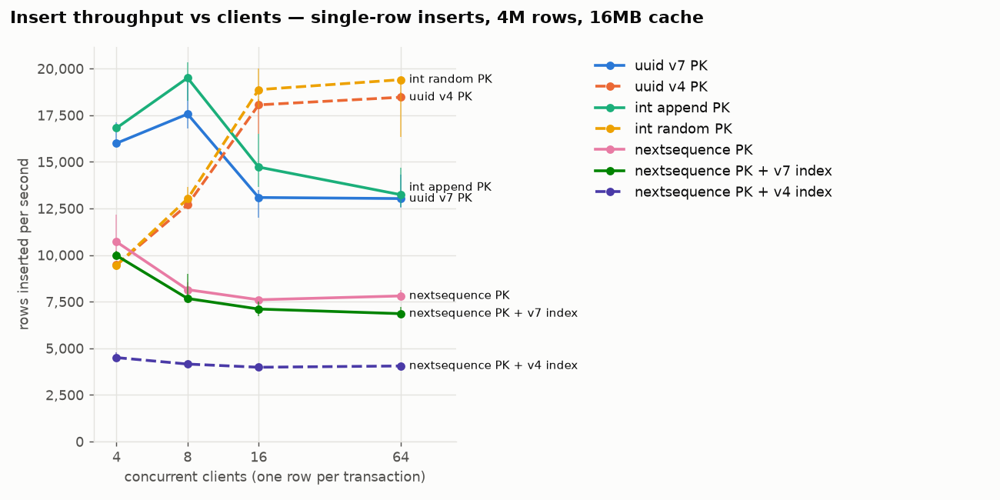
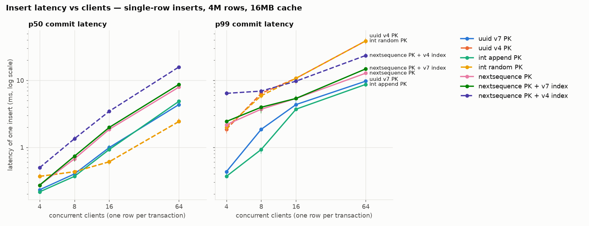
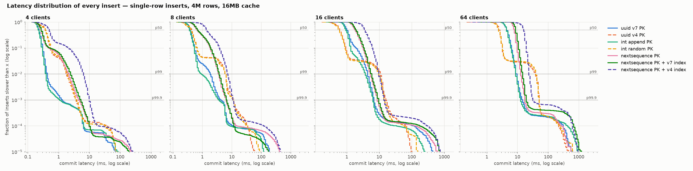
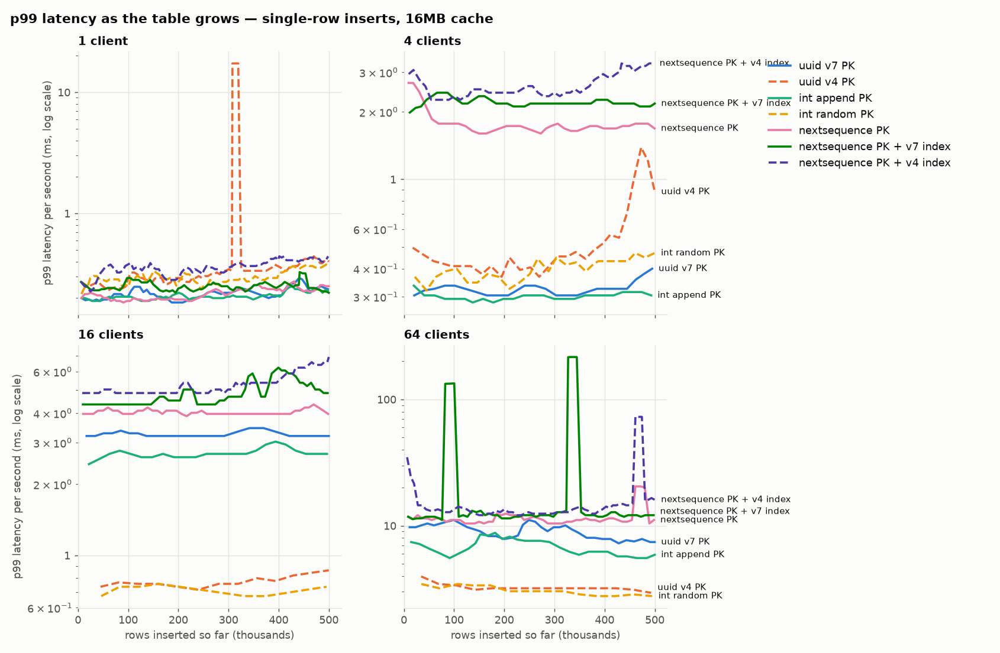
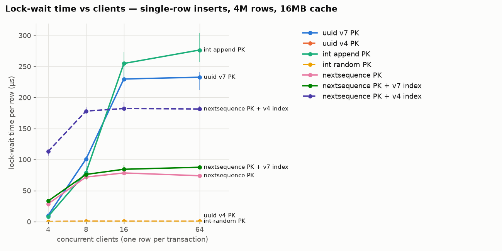
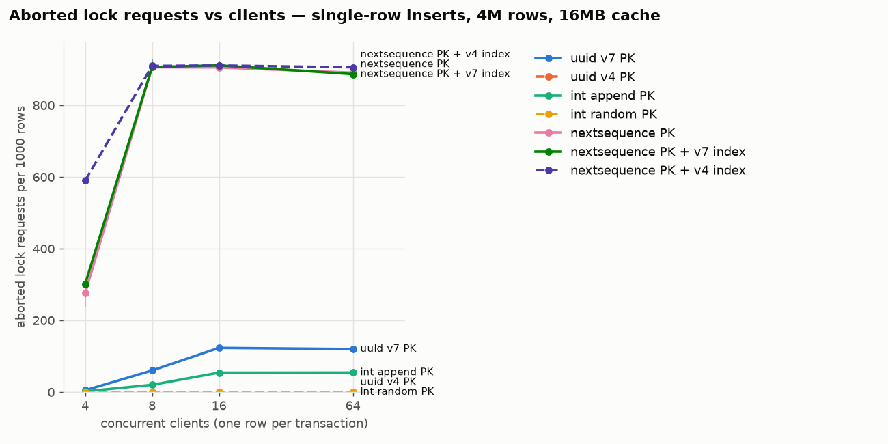
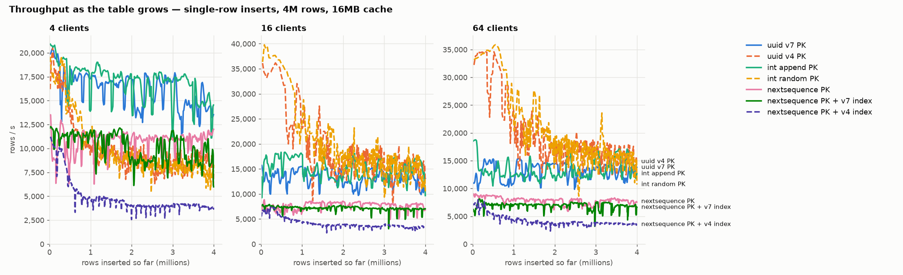
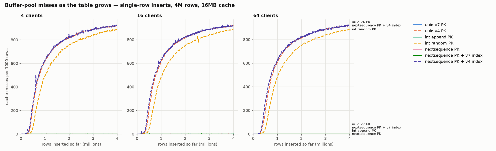
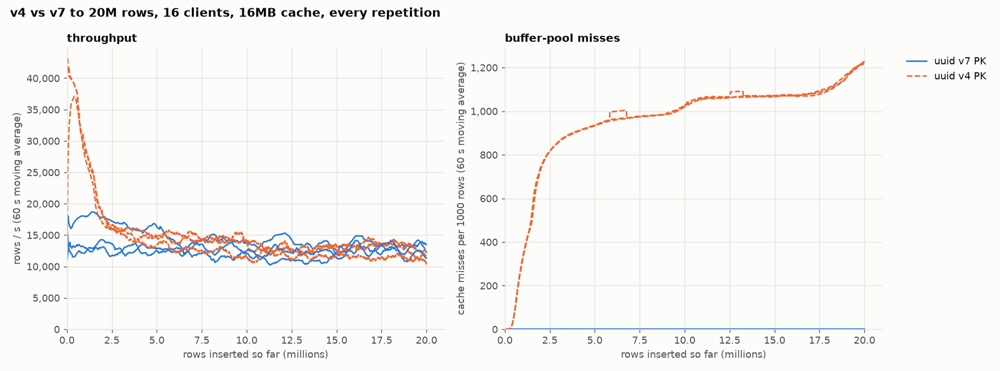
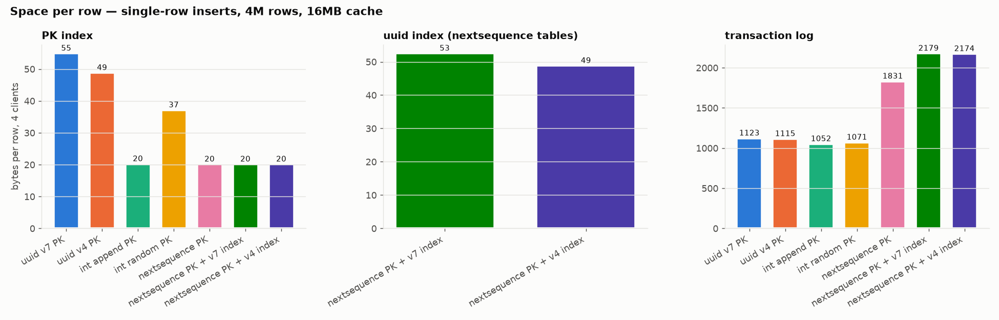

# Insert benchmark: UUID v7 vs UUID v4 vs integer keys in comdb2

This benchmark measures how the order of primary-key values affects
single-row insert performance in comdb2. It compares:

- time-ordered UUIDs (v7) against random UUIDs (v4);
- both against integer keys inserted in order (append) and at random;
- three tables whose id is assigned by the server with `nextsequence`: the
  sequence alone, and the sequence plus a uniquely indexed v7 or v4 UUID
  column.

It also tests one specific concern: that v7 keys, which all land at the
right-most leaf page of the index, make concurrent writers contend on that
page.

## Findings

The tables grow to 4M rows against a 16MB cache, so by the end of a run the
random-key indexes are 9–12x the cache (v4 PK index about 195MB, int random
about 148MB). "Last 1M rows" below means throughput measured from row 3M to
row 4M, once v4 misses the cache on about 906 of every 1000 inserts.

1. **v4 beats v7 from 16 clients up at 4M rows, but the lead is gone by 20M.**
   - Over the last 1M rows, v4 is 1.16–1.18x faster than v7 (14.7k vs 12.6k
     rows/s at 16 clients; 15.4k vs 13.1k at 64). Over the whole run it is
     1.38–1.42x faster. In the earlier 500k-row run, where the v4 index was
     only about 1.5x the cache, it was 2.3–2.6x faster.
   - v4 slows down as its index outgrows the cache: at 16 clients it runs at
     34–36k rows/s over the first 500k rows and 13.7–15.9k over the last 1M.
     v7 holds steady at 12.6–13.1k.
   - v4 stays ahead because v7's problem is still there. Every v7 insert
     modifies the same last leaf page, and with page locks it holds that lock
     until commit, so concurrent inserts queue and some deadlock. From 16
     clients up, v7 has 230–233 µs of lock wait and 58–60 deadlocks per 1000
     rows; v4 has under 1 µs and 0.01. A page read from NVMe still costs less
     than that queue.
   - int append behaves like v7 (255–276 µs of lock wait per row) and is within
     12% of it.
   - A longer run of v4 and v7 alone, at 16 clients to 20M rows, shows the lead
     disappearing. By then the v4 index is about 917MB, 57x the cache. Over the
     last 10M rows v4 ÷ v7 is 0.93–1.09 across the three repetitions, which is
     within the spread between repetitions. v4's misses pass one per insert at
     about 10M rows and reach about 1.18 per insert over the last 2M, so some
     inserts must also miss on pages above the leaves. See
     [Longer run](#longer-run-v4-vs-v7-to-20m-rows).

2. **At 4 and 8 clients, v7 is well ahead.** Over the last 1M rows v7 is 2.0x
   faster than v4 at 4 clients (16.1k vs 8.3k rows/s) and 1.46x faster at 8
   (16.4k vs 11.2k). Over the whole run it is 1.7x and 1.38x faster. With
   fewer writers there is less lock contention, so each v4 cache miss shows up
   directly in the throughput. In the 500k-row run the two were within 10% at
   4 clients.

3. **The in-order keys peak at 8 clients, which is where `maxwt` caps the
   master.**
   - v7 and int append are fastest at 8 clients (17.6k and 19.5k rows/s) and
     lose about 25% at 16 (13.1k and 14.7k). Between 8 and 16 clients, v7's
     lock wait per row goes from 101 to 230 µs and its deadlocks from 29 to 60
     per 1000 rows. v4 and int random gain 42–45% over the same step.
   - From 16 to 64 clients little changes: v7, v4 and int random stay within
     3%, int append loses 10%, and the lock wait and deadlock rates are flat.
   - The master applies at most `maxwt` (8) transactions at once
     (`gbl_maxwthreads`, checked when a request is handed to a writer thread in
     `db/handle_buf.c`). Further transactions wait in a queue, and each
     deadlock retry lowers the cap by about one until that transaction
     finishes. For these inserts, page locks are only taken in those writer
     threads.
   - So from 16 clients up, the master always has 8 transactions applying,
     which explains the plateau. A likely explanation for the peak is that 8
     clients do not keep all 8 writer slots busy, since each client spends part
     of every insert outside the master, while 16 clients do. With in-order
     keys every extra concurrent writer joins the queue for the last leaf page.
     How many writers were busy at 8 clients was not measured, and other
     `maxwt` values were not tested.

4. **v4's throughput lead comes with a worse tail.** v4's p99 is higher than
   v7's at every client count: 1.86 vs 0.43 ms at 4 clients, 6.40 vs 1.86 ms
   at 8, 10.75 vs 4.35 ms at 16, and 38.9 vs 9.7 ms at 64. Its p50 is still
   lower from 16 clients up (2.43 vs 4.35 ms at 64). At 16 clients, the slow
   v4 inserts are the 3–4% that have to write a dirty page out of the cache
   before they can read their own; see
   [Why some v4 inserts take 4–15 ms](#why-some-v4-inserts-take-415-ms). The
   cost is the allocator's search for a clean buffer, not the write: capping
   that search at 32 buckets brings v4's p99 from 9.7–10.8 ms to 4.35 ms. The
   tail is a small-cache effect: with the index still 12x the cache, v4 has
   the lower p99 from a 256MB cache up. See
   [Cache-size sweep and two allocator prototypes](#cache-size-sweep-and-two-allocator-prototypes).

5. **`nextsequence` is the slowest choice.**
   - It is 1.6–2.4x slower than a client-side counter (10.7k vs 16.8k rows/s
     at 4 clients; 8.1k vs 19.5k at 8), and it is fastest at 4 clients.
   - From 8 clients up, nearly every second insert deadlocks (443–456 per 1000
     rows).
   - Each insert writes about 770–780 more bytes of log than int append.
   - The cause is in the code: each insert reads, deletes and re-adds the
     table's sequence counter in llmeta inside the insert's own transaction
     (`bdb_increment_and_set_sequence`, `bdb/llmeta.c:4044`). So every
     inserter into the table serializes on that one record, whatever the key
     type.

6. **For the sequence + UUID tables, the UUID order now matters a lot.** The
   v7 index is 1.7–2.2x faster than the v4 index (10.0k vs 4.5k rows/s at 4
   clients; 7.7k vs 4.2k at 8; 7.1k vs 4.0k at 16; 6.9k vs 4.1k at 64), and has a lower p99 at
   every client count. The v4 index misses the cache on about 697 of every
   1000 inserts over the run. Every insert already serializes on the sequence
   record, so a page read for the v4 index lengthens that serialized section:
   from 8 clients up, lock wait is 178–182 µs per row with the v4 index
   against 76–88 µs with the v7 index.

**Index size.** v7's PK index is larger than v4's (52–55 vs 49 bytes per row).
The UUID index on the sequence tables shows the same pattern (53–57 vs 49).

## Choosing between v4 and v7

Default to v7. v4 is faster only for many concurrent single-row inserts into
one table, when throughput matters more than tail latency, and only while its
index is not many times larger than the cache. These are the questions to ask about the workload, in order of how
much they decide:

1. **How many transactions insert into this table at the same time?** Count
   concurrent writers to the table, not clients of the application, and
   compare with `maxwt` (8 by default).
   - Up to 8: v7. Once the v4 index is larger than the cache, v7 is 1.4–2.0x
     faster, and it was within 10% of v4 when the index fit.
   - 16 or more: v4 has more throughput until its index is many times the
     cache (see question 3), because every v7 insert waits for the lock on the
     last leaf page. int append keys lose to random keys the same way, so this
     is a property of in-order keys, not of UUIDs.
2. **Are inserts batched?** With 100 rows per transaction, v7 was ahead at
   every client count (see the git history of this directory). A batch
   touches many pages whatever the key order, and v4 pays a cache miss on most
   of them. The v4 case above applies only to one row per transaction.
3. **How large will the v4 index get compared with the cache?** Estimate about
   49 bytes per row, at the table's expected size rather than its size today.
   At 16 or more clients, v4 was 2.3–2.6x faster than v7 with its index at
   about 1.5x the cache, 1.16–1.18x faster at about 12x, and even with v7 at
   about 57x. v7 does not miss
   the cache, because its inserts only touch the right edge of the index.
4. **Does the application have latency targets?** v7's p99 is 2.5–4.3x lower
   than v4's at every client count. v4's p50 is lower only from 16 clients up.
5. **Is the id assigned with `nextsequence`?** If the table has a
   `nextsequence` PK and a UUID column, index the UUID as v7: it was 1.7–2.2x
   faster than v4 at every client count. `nextsequence` itself is the larger
   cost, 1.6–2.4x slower than a counter generated by the client, so consider
   avoiding it.

| workload | choose |
|---|---|
| batched inserts, any concurrency | v7 |
| up to 8 concurrent writers to the table | v7 |
| latency targets (p99) | v7 |
| `nextsequence` PK plus a UUID column | v7, and reconsider `nextsequence` |
| more than 8 concurrent single-row writers, throughput first | v4 while its index is near the cache size (up to 2.5x); 1.2x at 12x the cache, no gain at 57x |

Not covered by this benchmark: reads (v7 keeps recently inserted rows
together, which helps queries for recent data), updates and deletes,
replication, rowlocks, and other `maxwt` values. v7 values also reveal when the
row was created, which matters for ids shown outside the application.

## What was run

**Workloads.** Every workload inserts one row per transaction (a single-row
`INSERT` in autocommit) and measures writes only. Every table also has
`longlong v` (random) and `byte pad[100]` (random bytes).

| workload | key columns and indexes | who generates the key |
|---|---|---|
| `int_seq` (int append PK) | `longlong k`, PK | client: shared counter, one value per insert |
| `int_rand` (int random PK) | `longlong k`, PK | client: uniform random 64-bit value |
| `v7` (uuid v7 PK) | `byte k[16]`, PK | client: RFC 9562 v7, 48-bit Unix milliseconds then random bits (no counter within a millisecond) |
| `v4` (uuid v4 PK) | `byte k[16]`, PK | client: RFC 9562 v4 |
| `nextseq` (nextsequence PK) | `longlong id dbstore=nextsequence`, PK | server |
| `nextseq_v7` | `id` as above, PK; `byte u[16]` v7, unique index | server for id, client for u |
| `nextseq_v4` | `id` as above, PK; `byte u[16]` v4, unique index | server for id, client for u |

**Load and size.**
- 4, 8, 16 or 64 concurrent clients. 1 client was left out: at this table
  size it would have taken longer than the rest of the matrix combined.
  8 clients was added in a second pass, after the others had run.
- Each run inserts 4M rows into a freshly created table.
- 3 repetitions of each of the 28 workload/client combinations: 84 runs.
- Within each repetition, the run order is shuffled so that drift on the host
  does not line up with one workload.

**Cache.** comdb2's cache is set to 16MB, so the random-key indexes end up
9–12x larger than the cache. comdb2 raises any cache below `cachekbmin` up to it
(64MB by default), so the lrl lowers `cachekbmin` to match. comdb2 uses direct
I/O by default (`directio ON`), so a cache miss is a real NVMe read; the host's
1.1 TiB of RAM does not act as a hidden page cache.

**Between runs.** The table is dropped and recreated, and the cache is flushed
(`sys.cmd.send('flush')`).

**What each run records.**
- `results/main/runs.csv`, one row per run:
  - throughput and commit-latency percentiles
  - deltas of server counters from `comdb2_metrics`: lock waits, lock-wait
    time, aborted lock requests, deadlocks, cache hits and misses
  - bytes written to the transaction log (`bdb logstat`)
  - on-disk size of the data and index files after a flush
- `results/main/ts/<run>.ts.csv`: the same client and server counters sampled
  every second.
- `results/main/ts/<run>.hist.csv`: the full commit-latency histogram for the
  run.

## Setup

From `results/main/env.txt`:

| | |
|---|---|
| host | c2btda-pw-188, one of the least loaded C2BTDA hosts when the run started; the 20M-row run used c2btda-pw-922 |
| CPU | 2x Xeon Gold 6240, 72 logical CPUs, 2 NUMA nodes |
| RAM | 1.1 TiB |
| disk | XFS on LVM over Intel P4510 NVMe (SSDPE2KX080T8) |
| OS | RHEL 8.10, kernel 4.18.0-553 |
| comdb2 | `a6948d3ff` (branch `uuid-v7`), RelWithDebInfo, gcc 8.5 |
| topology | one node; clients run on the same host |
| locking | page locks (`init_with_rowlocks 0`) |
| writer threads | `maxwt 8` (default): at most 8 transactions are applied on the master at once |
| other settings | defaults: `maxretries 500`, `penaltyincpercent 20`, `checkpointtime 60`, `logfilesize 40MB` |
| run time | 4, 16 and 64 clients: 2026-10-14 19:08 to 2026-10-15 02:55 EDT. 8 clients: 2026-10-15 14:40–17:11 EDT. 20M rows: 2026-10-16 01:13–03:43 EDT. 762 minutes of measured insert time in all |

The database registers with a private pmux on port 15105. The host's shared
pmux handed out a port that another process was already using for UDP.

## Results

Each point is the median of 3 repetitions. Whiskers show min..max. The median
spread between repetitions is 8% of the median; the worst case is 21%
(`nextsequence` at 4 clients). Full tables for every metric are in
[`results/summary.md`](results/summary.md).

### Throughput



Whole run, rows/s:

| workload | 4 clients | 8 clients | 16 clients | 64 clients |
|---|---:|---:|---:|---:|
| uuid v7 PK | 15,993 | 17,560 | 13,084 | 13,026 |
| uuid v4 PK | 9,466 | 12,694 | 18,051 | 18,459 |
| int append PK | 16,809 | 19,497 | 14,715 | 13,233 |
| int random PK | 9,442 | 13,014 | 18,868 | 19,401 |
| nextsequence PK | 10,705 | 8,142 | 7,600 | 7,805 |
| nextsequence PK + v7 index | 9,972 | 7,669 | 7,103 | 6,855 |
| nextsequence PK + v4 index | 4,499 | 4,152 | 3,981 | 4,050 |

Last 1M rows (row 3M to row 4M), rows/s:

| workload | 4 clients | 8 clients | 16 clients | 64 clients |
|---|---:|---:|---:|---:|
| uuid v7 PK | 16,117 | 16,395 | 12,628 | 13,093 |
| uuid v4 PK | 8,254 | 11,212 | 14,700 | 15,440 |
| int append PK | 15,777 | 17,938 | 14,609 | 14,062 |
| int random PK | 7,743 | 10,399 | 14,760 | 15,312 |
| nextsequence PK | 10,994 | 7,894 | 7,423 | 7,746 |
| nextsequence PK + v7 index | 9,625 | 7,462 | 7,205 | 6,685 |
| nextsequence PK + v4 index | 3,977 | 3,647 | 3,472 | 3,656 |

### Latency




The second chart shows, for every insert in all three repetitions, the
fraction that took longer than a given latency. The dotted lines mark p50, p99
and p99.9.

- **4 and 8 clients:** v7 and int append are fastest at every percentile
  through p99.99. The random keys have a shoulder of slow inserts from about
  p95. What these inserts wait for was not measured at 4 and 8 clients; at 16
  clients the 4–15 ms shoulder is dirty-page evictions (see
  [below](#why-some-v4-inserts-take-415-ms)).
- **16 and 64 clients:** v4 and int random are fastest up to p95, cross over
  between p95 and p98, and are the slowest of all workloads at p99 and p99.9.
- **The tail beyond p99.9:** at 16 and 64 clients every workload reaches
  hundreds of milliseconds. For the in-order and sequence workloads these are
  mostly inserts that deadlocked and were retried after comdb2's backoff sleep.
  v4 and int random almost never deadlock but still reach 220–240 ms at p99.99
  with 64 clients; that tail was not investigated.

**Why v4 has the lower median but the worse tail.** Each client sends its next
insert as soon as the last one commits, so mean latency is clients ÷
throughput. At 16 clients that gives 1.25 ms for v7 and 0.91 ms for v4, which
match the measured means. v4's higher throughput forces its mean down, and the
two distributions differ in shape:

- **v7's cost falls on every insert.** From 8 clients up, v7 waits for a lock
  0.97 times per row, and from 16 clients up each wait averages 235–245 µs:
  inserts queue for the last leaf page. That shifts the whole distribution, so
  v7's p50 is close to its mean (0.99 vs 1.25 ms at 16 clients).
- **v4's cost falls on a few inserts.** It waits for a lock 0.003 times per
  row, but 3.0% of its inserts at 16 clients take 4 ms or more (4.1% in the
  20M-row run). Those raise its mean and p99 but not its median: at 16 clients
  its p50 is 0.61 ms against a mean of 0.91.

At 4 clients, where v7 has only 9 µs of lock wait per row, v7's p50 is the
lower one (0.23 vs 0.37 ms).

p99 latency, ms:

| workload | 4 clients | 8 clients | 16 clients | 64 clients |
|---|---:|---:|---:|---:|
| uuid v7 PK | 0.43 | 1.86 | 4.35 | 9.73 |
| uuid v4 PK | 1.86 | 6.40 | 10.75 | 38.91 |
| int append PK | 0.37 | 0.93 | 3.71 | 8.70 |
| int random PK | 1.98 | 5.89 | 10.75 | 38.91 |
| nextsequence PK | 2.18 | 3.71 | 5.38 | 12.80 |
| nextsequence PK + v7 index | 2.43 | 3.97 | 5.38 | 14.85 |
| nextsequence PK + v4 index | 6.40 | 6.91 | 9.73 | 23.55 |



### Contention




The two kinds of contention look different:

- **In-order keys (v7, int append)** mostly *wait*: 230–276 µs of lock wait per
  row from 16 clients up.
- **The `nextsequence` tables** wait less (72–88 µs per row from 8 clients
  up; 178–182 with the v4 index) but abort far more often: about 890–910 aborted lock requests and
  443–456 deadlocks per 1000 rows. Each
  deadlock sends the transaction into comdb2's retry path, which sleeps for a
  random interval and lowers the effective number of write threads
  (`handle_op_local`, `db/sltdbt.c`).

### Why some v4 inserts take 4–15 ms

At 16 clients, 3.0% of v4 inserts take 4 ms or more, although a page read from
NVMe takes well under 1 ms. These slow inserts are the ones that find no clean
buffer in the cache and have to write a dirty page out before they can read
their own.

comdb2's cache flusher (the memp trickle thread) writes dirty pages in the
background, trying to keep `memptricklepercent` of the cache clean (99 by
default). Three extra v4 runs at 16 clients to 4M rows, one repetition each on
c2btda-pw-922 (`results/trickle/`), changed only that setting. The cache
counters were sampled every second from `bdb cachestat`:

| `memptricklepercent` | rows/s | p50, ms | p99, ms | inserts ≥ 4 ms | inserts that wrote a dirty page | median dirty share of the cache |
|---|---:|---:|---:|---:|---:|---:|
| 99 (default) | 17,317 | 0.54 | 11.8 | 3.7% | 3.4% | 65% |
| 50 | 14,228 | 0.54 | 11.8 | 6.4% | 6.0% | 95% |
| 1 (flusher idle) | 2,945 | 5.89 | 15.9 | 58% | 57% | 97% |

- The share of inserts at 4 ms or more follows the share that wrote a dirty
  page (`st_rw_evict`). Per second, p99 correlates with it (+0.59 and +0.62 at
  99 and 50).
- Even at the default the flusher does not keep up: about 65% of the cache is
  dirty.
- The log flush that write-ahead logging requires before the write is not the
  cost: log syncs fell from 34.5 to 11.2 per 1000 rows between 99 and 1 while
  the slow inserts went up.

The cost is in how the buffer allocator looks for a page to evict
(`__memp_alloc_flags`, `berkdb/mp/mp_alloc.c`):

- It walks the cache's hash buckets in turn. For each candidate bucket it
  releases the cache's region lock, locks the bucket, looks at the bucket's
  oldest buffer, and takes the region lock again. Every buffer allocation in
  the cache, and so every cache miss, goes through that one region lock.
- It skips dirty buffers until it has visited as many buckets as the hash
  table holds (2,053 for this 16MB cache). Only then does it write a dirty
  buffer out.
- So each dirty eviction comes after a full sweep. That predicts about
  0.034 × 2,053 ≈ 70 buckets visited per row at the default and
  0.57 × 2,053 ≈ 1,170 at 1; `st_alloc_buckets` counted 77 and 1,210.

Stack samples of the server during the default run (60 samples 0.25 s apart,
from row 1.5M, 461 samples of threads applying an insert;
`results/trickle/profile99/eustack.txt`) show where the time goes:

| where a thread applying an insert was | share of samples |
|---|---:|
| allocator: taking or releasing the region lock between buckets | 33% |
| reading a page from disk | 29% |
| commit | 8% |
| allocator: scanning | 3% |
| allocator: writing the dirty page | 3% |

A CPU profile of the same run (`perf`, 15 s) puts 20% of the server's CPU in
`pthread_mutex_lock` and `pthread_mutex_unlock`.

The number of hash buckets grows with the cache: about one per 10KB, within
each cache region of up to `cache_seg_size` (1GB by default). With a production
cache a sweep would visit about 100,000 buckets rather than 2,053. Whether
dirty evictions then cost even more was not measured.

### Cache-size sweep and two allocator prototypes

The explanation above came from one cache size and from correlation. This
section tests it two ways: by changing the cache size, and by changing the
allocator.

**Setup.** All runs were on c2btda-pw-922 at 16 clients with single-row
inserts (`results/sweep/`, `scripts/run_sweep.sh`). For each cache size the
table holds enough rows for its PK index to be about 12x the cache, as in the
16MB runs above: 4M rows for 16MB, 16M for 64MB, 64M for 256MB and 256M for
1GB. Each table was loaded in 100-row transactions and copied at each of those
sizes. Each run starts a server with the given cache on a fresh copy and
inserts 10% more rows (at least 1M) one row at a time, sampling `bdb cachestat`
every second over one connection.

All runs used one server binary, built from the same source plus
`proto/mp_alloc-prototype.patch`. The patch adds two switches to the buffer
allocator (`__memp_alloc_flags`), each read from the environment:

- **Cap the clean-only search (`cap32`).** Normally the allocator skips dirty
  buffers until it has visited as many buckets as the hash table holds. With
  the cap, once it has visited 32 buckets it writes out the next dirty victim
  instead.
- **Search without the region lock (`unlocked`).** Normally the allocator
  releases and retakes the cache region's lock around every candidate bucket.
  With this switch it searches without that lock and takes it only to allocate
  from the region's free memory.

`base` has both switches off, which is the stock code path. `both` has both on.
There were 3 repetitions at 16MB and 64MB, 2 at 256MB and 1 at 1GB. Latency
percentiles come from a histogram with 8 buckets per power of two, so 4.35,
4.86, 5.38 and 5.89 ms are neighbouring buckets.

**16MB: the fresh runs reproduce the gap, and capping the search closes it.**
Ranges are over the 3 repetitions; counters are per 1000 rows.

| | rows/s | p50, ms | p99, ms | p99.9, ms | inserts ≥ 4 ms | dirty evictions | buckets per allocation | region-lock waits |
|---|---:|---:|---:|---:|---:|---:|---:|---:|
| v7 | 15.4–17.1k | 0.74–0.86 | 3.20–3.71 | 6.4–6.9 | 0.33–0.53% | 0 | 1.9 | 0.1 |
| v4 `base` | 14.3–15.1k | 0.61 | 9.73–10.75 | 15.9 | 5.1–5.8% | 40–46 | 91–108 | 6,900–8,200 |
| v4 `cap32` | 19.0–19.6k | 0.61–0.67 | 4.35 | 6.4 | 1.48–1.58% | 381–402 | 15–16 | 93–112 |
| v4 `unlocked` | 14.6–15.1k | 0.61–0.67 | 5.89 | 8.7 | 5.6–6.7% | 80–83 | 184–193 | 41–55 |
| v4 `both` | 18.4–19.2k | 0.67 | 4.35 | 6.4 | 1.46–1.53% | 365–372 | 15 | 42–46 |

- v4 `base` matches the earlier 16MB runs (p50 0.61 ms, p99 10.75 ms in two of
  three repetitions), so the preload-then-measure method reproduces the gap.
- With the cap, v4's p99 falls from 9.7–10.8 ms to 4.35 ms in all three
  repetitions, close to v7's 3.2–3.7 ms. Its share of inserts at 4 ms or more
  falls from 5.1–5.8% to about 1.5%, and its throughput rises by about 27%.
  This is the causal evidence the correlation above lacked: change only how
  long the allocator searches for a clean buffer, and the tail goes away.
- With the cap, inserts write dirty pages out about 9 times as often (381–402
  against 40–46 per 1000 rows) and still get faster. So the cost was never the
  write. It was the search that came before it.
- Searching without the region lock removes about 99% of the region-lock waits
  and lowers p99 to 5.89 ms, but the share of slow inserts and the throughput
  do not change. So the per-bucket lock round trip is part of what makes a
  slow insert slow, but not the reason it is slow. The rest is presumably the
  sweep itself (locking each bucket's mutex in turn); that was not measured
  separately.
- With both switches on, the results are the same as with the cap alone.

**Larger caches: the tail and the dirty evictions disappear together.**
Medians over the repetitions:

| cache | v4 rows/s | v7 rows/s | v4 p50 / p99, ms | v7 p50 / p99, ms | v4 inserts ≥ 4 ms | v4 dirty evictions per 1000 rows | median dirty share of the cache |
|---|---:|---:|---:|---:|---:|---:|---:|
| 16MB | 15.1k | 16.7k | 0.61 / 10.75 | 0.80 / 3.46 | 5.4% | 44 | 50% |
| 64MB | 19.8k | 15.6k | 0.54 / 5.38 | 0.80 / 3.46 | 2.4% | 1.4 | 12% |
| 256MB | 26.5k | 14.7k | 0.54 / 1.09–1.86 | 0.86–0.93 / 3.71–3.97 | 0.11–0.56% | 0 | 3–8% |
| 1GB | 17.4k | 13.4k | 0.54 / 1.60 | 0.86 / 3.97 | 0.39% | 0 | 2% |

- With the index at the same multiple of the cache, a larger cache keeps each
  page in memory for longer, so the cache flusher has more time to write it
  before it is evicted. The dirty share of the cache falls from about 50% at
  16MB to 12% at 64MB, and dirty evictions all but stop.
- At 256MB and 1GB, v4 has both the lower median and the lower p99, and it is
  1.3–1.8x faster than v7. The tail that motivated this section is a small-cache
  effect. v7's p99 stays at 3.2–4.0 ms at every size, from its queue for the
  last leaf page.
- At 64MB, dirty evictions are rare (1.4 per 1000 rows), but each one still
  sweeps the hash table: the p99.9 of v4 `base` is 14.8–27.6 ms, and the cap
  brings it to 6.4–6.9 ms. The cap does not change v4's 2.4% share of inserts
  at 4 ms or more at 64MB, so those inserts are slow for another reason, which
  was not investigated. v7's share is 0.3–0.5%.
- At 256MB and above there are no dirty evictions for the switches to affect,
  and the variants are within the spread between repetitions.

**The 1GB runs also stalled, for an unrelated reason.** Every 1GB run had long
stretches below 2,000 rows/s: 402 of about 1,470 seconds for v4 `base`, 481
for `cap32`, 603 for `unlocked` and 99 for v7. This raises their p99.9 (78–94
ms for v4, 17 ms for v7) but barely moves p99. In the three v4 runs the
longest single allocation search, 154k–302k buckets, is more than a full lap of
the 131,071-bucket region (v7's was 120k). That matches a separate problem found at a 2GB cache: when a 32KB
`sqlite_stat1` page has to be read into a cache full of 4KB pages, the
allocator frees 4KB buffers one at a time under the region lock, hoping they
merge (written up outside this repository). Whether the 1GB stalls have the
same cause was not checked. The stats sampler here used one connection
throughout, so the stalls are not caused by it opening connections.

### Throughput and cache misses as the table grows




v4 starts missing the cache once the table passes 180k–320k rows (int random:
270k–430k), and the misses climb to about 906 per 1000 rows over the last 1M
rows (868 for int random). Its throughput falls with them, and at 16 and 64
clients it ends up just above v7. v7, int append and plain `nextsequence` never
miss the cache.

### Longer run: v4 vs v7 to 20M rows



v4 and v7 only, 16 clients, 20M rows per run, 3 repetitions (`results/long/`).
At the end, the v4 PK index is about 917MB and the v7 index 1,027–1,050MB.

- v4 runs at 21–22k rows/s over the first 2M rows and 11.0–12.9k over the last
  2M. v7 runs at 11.7–13.4k over the last 2M and never misses the cache.
- v4 ÷ v7, by repetition:

  | | rep 1 | rep 2 | rep 3 |
  |---|---:|---:|---:|
  | row 3M to 4M | 1.00 | 1.16 | 1.09 |
  | row 10M to 20M | 0.96 | 1.09 | 0.93 |
  | row 18M to 20M | 0.90 | 1.03 | 0.94 |

- v4's misses per 1000 rows pass 1,000 at about 10M rows and average about
  1,180 over the last 2M rows.
- v4's p99 stays about 3x v7's (12.8 ms vs 4.0–4.9 ms); its p50 stays lower
  (0.67–0.74 ms vs 0.93–1.09 ms).
- v7 ran 10–15% faster late in repetition 1 than in repetitions 2 and 3; the
  cause was not found.

### Space



The `nextsequence` tables write about 1,830 bytes of log per row (2,170–2,180
with the UUID index), against about 1,050–1,140 for the client-generated keys. The
difference is the delete and add of the llmeta sequence record in every insert.

## Caveats

- **No 1-client point.** It was dropped to fit the run into one night. The
  500k-row run in the git history has it: v7 was 14% faster than v4 there.
- **The 20M-row run is narrower.** It covers v4 and v7 at 16 clients only, and
  ran on c2btda-pw-922 (same hardware) because pw-188 was busy with another
  user's benchmark that night.
- **Different host from the 500k-row run.** That run used c2btda-pw-928; this
  one used c2btda-pw-188, which has the same hardware. Compare the two runs by
  ratios, not absolute rates.
- **Batched transactions.** Inserts with many rows per transaction behave
  differently, because each transaction then touches many random pages and
  contends whatever the key order. An earlier version of this benchmark with
  100-row transactions found v7 ahead of v4 at every client count; see the git
  history of this directory.
- **Configuration.**
  - Single node only, so there is no replication.
  - Default page locks; rowlocks were deliberately not tested.
  - `maxwt 8`, so the master applies at most 8 transactions at once.
- **Shared host.** Clients and server share the host. The load average before
  each run ranged from 2.7 to 18.6 (median 7.5); it includes the benchmark's own
  threads from the previous run.
- **Fresh table, not fresh database.** The database is created once per pass:
  once for 4, 16 and 64 clients and once for 8 clients. Each run gets a freshly
  created table, but the transaction log and the files of dropped tables carry
  over within a pass.
- **Not measured.** Reading back the generated id after an insert.

## Reproducing

On a host with comdb2's build dependencies, with the source at `$BASE/src` and
a CMake build at `$BASE/build` (default `BASE=/bb/comdb2a/$USER/uuid-v7`):

```sh
cmake -S $BASE/src -B $BASE/build -G Ninja -DCMAKE_BUILD_TYPE=RelWithDebInfo && ninja -C $BASE/build
cp -r uuid-v7 $BASE/bench-src
make -C $BASE/bench-src/bench SRC=$BASE/src BUILD=$BASE/build
$BASE/bench-src/scripts/run_all.sh $BASE/results          # about 13 hours
python plot.py $BASE/results                              # needs matplotlib
```

## Files

| path | what |
|---|---|
| `bench/uuidbench.c`, `bench/Makefile` | the client: key generators, insert threads, 1-second sampler, latency histogram |
| `scripts/ctl.sh` | create, start and stop the database; recreate the table; read log bytes and file sizes |
| `scripts/run_matrix.sh` | one configuration: shuffled runs, one row per run in `runs.csv` |
| `scripts/run_all.sh` | the configuration reported above |
| `scripts/env.sh` | records the host and database setup (`env.txt`) |
| `plot.py` | generates `results/plots/*.png` and `results/summary.md` |
| `results/main/` | `runs.csv`, `env.txt`, and per-run time series and histograms in `ts/` |
| `results/long/` | the same for the 20M-row v4/v7 run |
| `scripts/run_trickle.sh` | v4 at 16 clients with three `memptricklepercent` settings, sampling `bdb cachestat` every second |
| `results/trickle/` | one directory per setting; `ts/<run>.stat.txt` holds the per-second `bdb cachestat` and `bdb logstat` output |
| `scripts/run_sweep.sh`, `sweep.py` | the cache-size sweep with the allocator switches, and its summary |
| `proto/mp_alloc-prototype.patch` | the two allocator switches (`MP_ALLOC_DIRTY_CAP`, `MP_ALLOC_UNLOCKED_SCAN`), applied to `berkdb/mp/mp_alloc.c` |
| `results/sweep/` | `runs.csv` and per-run time series, histograms and `bdb cachestat` samples for the sweep |
| `scripts/run_btda.sh`, `btda.py`, `results/btda/` | six workloads on a 200M-row table with a 2GB cache |
